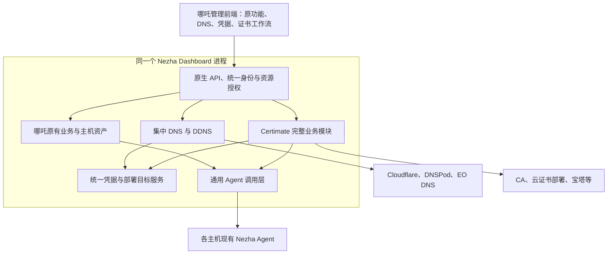

# 基于哪吒的 DNS、DDNS 与证书统一管理平台全量集成方案

## 一、项目定位与总体目标

以 Nezha Dashboard 为产品主体，保留哪吒的全部原有功能及管理前端，将 Certimate 的完整证书业务与界面原生集成其中，同时增加集中 DNS 管理、统一凭据、主机资产关联和资源委托授权。

最终形成一个以 Go 为后端的完整管理平台，统一管理：

- 主机资产、监控、告警、任务、终端和文件。
- Cloudflare、DNSPod、腾讯 EdgeOne 等服务商的账户与资源。
- 域名和 DNS 解析记录。
- 基于主机 IP 的 DDNS。
- 证书申请、自动续签、工作流、部署和通知。
- SSH、宝塔、云 API 等外部业务凭据。
- 子用户对指定子域、证书流程和部署目标的使用权限。

本方案按完整产品的最终形态设计，所有模块纳入同一次完整交付和验收。

“全部功能”以选定上游版本的功能清单为基准，并通过固定版本、来源映射和回归验证持续跟进上游。

### 1.1 最终交付形态

| 层面 | 最终形态 |
|---|---|
| 管理前端 | 在哪吒管理前端中增加原生页面；一个管理前端构建、一套路由、一个登录会话 |
| 哪吒功能 | 保留主机、监控、告警、任务、终端、文件、DDNS 等原有功能 |
| 证书功能 | 完整迁入 Certimate 的证书资产、工作流设计器、签发、续签、部署、通知、运行历史和设置 |
| DNS 功能 | 将所需的彩虹集中 DNS 管理能力用 Go 实现，并接入哪吒原生页面 |
| 用户与授权 | 统一使用哪吒账号，增加对子域、证书、凭据用途和部署目标等资源的授权 |
| 后端进程 | 一个扩展后的 Nezha Dashboard 进程，统一管理各模块的启动、调度和停止 |
| 主机客户端 | 每台需要纳管的主机使用一份兼容版本的 Nezha Agent |
| 发布升级 | 一个项目的构建、安装、升级和备份入口 |

“一个管理前端”特指后台管理应用。哪吒原有的公开监控页面及主题继续保留。

现有宝塔面板继续用于网站和服务管理，统一平台通过宝塔 API 或 Agent 完成证书部署。

### 1.2 三个上游的使用方式

| 上游 | 在项目中的地位 | 整合方式 |
|---|---|---|
| 哪吒 | 产品主体 | 在原 Dashboard 和管理前端上扩展 |
| Certimate | 完整证书业务模块 | 保留业务引擎、工作流、提供商及页面，改造入口、API 和权限边界 |
| 彩虹 DNS | DNS 功能与厂商适配参考 | 将所需 PHP 业务逻辑移植为 Go，接入统一资源与授权体系 |

彩虹用户管理的操作体验可以参考，但账号、身份和授权数据统一归入哪吒。

---

## 二、总体架构



### 2.1 核心约束

1. **一个管理应用**

   所有管理页面使用统一路由、身份、导航、主题和 API。

2. **一个 Dashboard 运行时**

   哪吒统一启动和停止 DNS、证书、调度、凭据和部署模块。

3. **每个业务对象只有一个权威来源**

   凭据、主机、证书、工作流和部署目标都使用稳定引用，避免多份可以独立编辑的数据。

4. **所有执行入口使用统一授权**

   页面操作、API、定时续签、DDNS 更新、工作流重试和恢复执行均受资源权限约束。

5. **完整保留上游业务能力**

   对账号、导航等重复能力进行统一；保留工作流节点、提供商、高级参数和实际业务行为。

---

## 三、管理前端集成方案

### 3.1 Certimate 页面完整迁入

| Certimate 能力 | 在哪吒中的呈现 |
|---|---|
| 证书列表、筛选、详情、下载、吊销、删除 | “证书管理”页面 |
| 工作流列表、创建、编辑、启停 | “证书工作流”页面 |
| 完整图形化设计器 | 哪吒原生路由下的工作流编辑页面 |
| 条件、延迟、Try/Catch、申请、上传、监控、部署、通知等节点 | 保留完整节点体系 |
| 全部 CA、验证方式、部署和通知提供商 | 保留注册项、配置表单和高级参数 |
| 工作流运行记录、节点输出、日志和取消操作 | 原生运行详情页面 |
| 预设与模板 | “证书预设”页面 |
| SSL 提供商、持久化、诊断等设置 | 合并到系统设置中的证书分组 |
| 账号、安全、语言、外观等功能 | 合并到统一账号与设置体系 |

当前 Certimate 路由包含工作流设计、运行历史、预设、证书、凭据和多组设置页面，迁移范围应覆盖完整业务界面。

参考源码：

- [Certimate 路由定义](https://github.com/certimate-go/certimate/blob/v0.4.35/ui/src/routers/index.tsx)

### 3.2 原生路由设计

以下为建议路由，实施时应与哪吒现有路由核对：

```text
/dashboard/dns
/dashboard/credentials
/dashboard/certificates
/dashboard/certificates/workflows
/dashboard/certificates/workflows/:id/design
/dashboard/certificates/workflows/:id/runs
/dashboard/certificates/presets
/dashboard/settings/certificates
```

DDNS 优先扩展哪吒现有页面，保留原有入口和使用习惯。

资源授权和部署目标页面接入统一管理导航。

### 3.3 React 与组件体系

本次核验的哪吒管理前端采用 React 19，Certimate 的项目入口采用 React 18。Certimate 的主要界面依赖支持向同一 React 版本统一；Ant Design 6 官方要求 React 18 及以上，并支持 React 19。

整合要求：

- React、ReactDOM 和类型依赖统一到哪吒采用的兼容版本。
- 保留哪吒的 React 根节点和主路由。
- 保留 Certimate 的 Ant Design 组件与工作流画布。
- 共用登录状态、语言实例、主题状态和通知入口。
- 将证书模块样式限制在模块范围。
- 统一全局 reset、主题变量、弹窗层级和 Portal 行为。
- 将 Certimate 原有绝对跳转地址改成哪吒原生路由。
- 保留工作流画布所需的初始化逻辑和依赖。

实际验证重点：

- 工作流拖拽与连接。
- 节点弹窗和表单联动。
- 页面挂载、卸载和状态恢复。
- 返回导航与浏览器历史。
- 直接打开深层链接。
- 深色模式和弹窗样式。
- 移动端管理布局。

参考资料：

- [Ant Design 6 迁移说明](https://ant.design/docs/react/migration-v6/)
- [React 19 升级指南](https://react.dev/blog/2024/04/25/react-19-upgrade-guide)

### 3.4 完整改造前端 API 层

Certimate 当前前端直接使用 PocketBase 的 collection、分页、批量操作和实时订阅接口，并围绕独立的超级用户登录状态工作。

迁移后的数据访问层统一调用哪吒原生 API，覆盖：

- 列表、详情、筛选、分页和批量操作。
- 工作流保存、发布、启停、运行与取消。
- 运行日志、节点输出和实时状态订阅。
- 证书下载、格式转换和吊销。
- 凭据管理。
- 通知测试。
- 系统诊断和设置。

授权要求：

- 使用当前哪吒用户的有效身份与权限。
- 列表、详情、导出、下载和实时事件执行相同的资源过滤。
- 浏览器不持有可以访问全部证书数据的 PocketBase 超级用户会话。
- 未登录状态进入统一登录流程。
- 权限不足时明确返回拒绝，不清空其他模块的正常登录状态。
- 分页和总数应基于授权后的资源集合生成。

参考源码：

- [Certimate 前端工作流 repository](https://github.com/certimate-go/certimate/blob/v0.4.35/ui/src/repository/workflow.ts)
- [Certimate PocketBase 客户端与认证](https://github.com/certimate-go/certimate/blob/v0.4.35/ui/src/repository/_pocketbase.ts)

---

## 四、Certimate 后端嵌入方案

### 4.1 直接迁入哪吒单一 Go 模块

以哪吒仓库为根，保留原有 `cmd/`、`model/`、`service/`、`pkg/` 和 `proto/` 结构。Certimate 业务代码直接迁入同一个 Go 模块，按业务职责组织，例如：

```text
internal/certificate
internal/dns
internal/credential
internal/authz
internal/deployment
web/admin
```

不保留独立的 Certimate 目录、Go 模块、启动程序或管理前端。迁移时保留原业务行为、提供商、迁移记录和源码来源映射，并调整原有导入路径。

证书业务通过哪吒内部应用服务提供以下能力：

| 接口边界 | 职责 |
|---|---|
| 引擎初始化 | 数据初始化、迁移、设置加载和提供商注册 |
| 业务服务 | 凭据、证书、工作流、运行、预设和设置操作 |
| 引擎启动 | 启动调度、后台执行器和清理任务 |
| 引擎停止 | 停止新任务、收敛执行状态、关闭内部资源 |
| 依赖注入 | 接收统一授权、凭据解析、Agent 执行和事件发布等服务 |

包依赖要求：

- Dashboard 调用内部证书服务，统一管理启动、调度和停止。
- 证书包通过明确接口使用统一授权、凭据和 Agent 能力，避免循环导入。
- Go 依赖版本由根目录唯一的 `go.mod` 和 `go.sum` 管理。
- 唯一管理前端位于 `web/admin`，证书页面直接迁入同一构建与路由。
- 本地参考源码不参与构建，不使用指向 `upstream/` 的依赖替换。

### 4.2 显式接管生命周期

Certimate 当前部分初始化绑定在 PocketBase 的 `OnBootstrap`、`OnServe` 和 `OnTerminate` 上，包括设置初始化、工作流调度和停止处理。

整合后的 Dashboard 应按明确顺序执行：

1. 初始化内部存储并运行迁移。
2. 加载设置和凭据服务。
3. 注册全部工作流节点与提供商。
4. 注册原生业务 API 和授权事件订阅。
5. 启动一次调度器和执行器。
6. 随 Dashboard 停止完成清理。

原 Certimate 的独立 HTTP 启动入口与静态 WebUI 服务入口不再参与统一产品的运行。

参考源码：

- [Certimate main.go](https://github.com/certimate-go/certimate/blob/v0.4.35/main.go)

### 4.3 迁移请求钩子中的业务副作用

Certimate 当前的工作流创建、修改和删除，通过 PocketBase 请求钩子更新定时任务；设置修改也通过请求钩子更新缓存。

原生哪吒 API 直接保存数据库记录，不会自然执行这些 HTTP 请求钩子。

应将相关行为提升为明确的应用服务：

| 应用服务 | 必须包含的行为 |
|---|---|
| 保存工作流 | 验证图与权限、保存、提交后更新调度 |
| 启停工作流 | 保存状态并增删对应调度 |
| 删除工作流 | 处理关联运行、删除数据、移除调度 |
| 更新设置 | 保存设置并刷新运行时缓存 |
| 启动运行 | 检查执行许可、保存运行与图快照、进入执行器 |
| 取消运行 | 更新取消意图并停止后续可停止的执行步骤 |

自动触发路径同样通过这些应用服务执行。

参考源码：

- [Certimate 工作流请求钩子](https://github.com/certimate-go/certimate/blob/v0.4.35/internal/workflow/pbhook.go)
- [Certimate 设置请求钩子](https://github.com/certimate-go/certimate/blob/v0.4.35/internal/settings/pbhook.go)

### 4.4 同进程内的任务隔离

证书申请、证书部署和 DNS 批量操作使用有并发限制的后台执行器。

要求：

- 分离不同业务的队列和并发限制。
- 为外部调用设置超时。
- 长任务通过运行 ID 查询状态。
- 避免长任务阻塞 Agent 心跳与监控处理。
- 明确各模块停止和取消的作用范围。
- 保留足够的运行状态用于故障核验。

---

## 五、统一数据、凭据与资产

### 5.1 最终存储结构

保留哪吒的 GORM 存储，同时将 PocketBase 作为 Certimate 的内部业务存储，两者由同一个 Dashboard 进程管理。

PocketBase 支持作为 Go 包嵌入应用。本项目使用其内部数据与业务组件能力，不增加独立管理界面、登录或监听入口。

内部双存储可以作为正式最终架构，以降低完整保留 Certimate 数据结构、迁移和业务行为的改写范围。

参考资料：

- [PocketBase Go 扩展与嵌入说明](https://pocketbase.io/docs/go-overview/)

### 5.2 数据唯一归属

| 数据 | 权威存储与业务归属 |
|---|---|
| 用户、角色、PAT、Agent 身份 | 哪吒 |
| 服务器、监控、原有任务等 | 哪吒原有模块 |
| 跨模块资源授权 | 哪吒新增授权模块 |
| DNS 账户绑定、Zone、子域范围、DDNS 绑定 | DNS 模块 |
| 可复用的主机和云部署目标 | 资产模块 |
| 外部业务凭据 | 统一凭据服务，底层扩展 Certimate `access` |
| ACME 账户、证书和私钥 | Certimate 证书模块 |
| 工作流、版本、运行、输出和日志 | Certimate 工作流模块 |
| 持久主机部署任务 | 哪吒主机部署服务 |
| 全局任务列表 | 聚合视图，读取各模块的权威状态 |

实现要求：

- 使用稳定的资源引用。
- 对哪吒与 Certimate 原有 ID 保留类型区分或显式映射。
- 不在两个存储中分别维护可以独立修改的 owner 和授权。
- 不由 GORM 任意修改 PocketBase 业务表。
- 不在聚合任务列表中维护第二套竞争性的成功、失败状态。
- 真实 DNS 记录和远程已部署证书的状态，以对应服务商或主机为最终核验对象。

### 5.3 统一凭据中心

凭据中心覆盖：

- Cloudflare API Token。
- DNSPod 对应授权配置。
- 腾讯云身份及其 DNSPod、EdgeOne 等产品用途。
- SSH 密钥或密码。
- 宝塔 API 凭据。
- CA 授权。
- 通知服务凭据。
- 其他 Certimate 提供商凭据。

不同认证格式应明确区分，不能将名称相似的授权参数直接混用。

各业务模块保存 `credential_ref`，执行时由统一凭据服务解析。哪吒现有 DDNS 配置中的供应商密钥，也应迁移或通过兼容适配层接入同一引用模型。

### 5.4 凭据权限

| 权限 | 含义 |
|---|---|
| 查看信息 | 查看名称、类型和适用资源 |
| 使用 | 允许服务端在指定资源上执行获准操作 |
| 查看或导出明文 | 读取实际密钥 |
| 修改与轮换 | 更新、停用或替换凭据 |

子用户可以获得“修改指定子域 DNS”的能力，无需取得实际云 API Token。

凭据服务按当前执行上下文检查：

- 凭据是否启用。
- 使用用途是否获准。
- 目标资源是否获准。
- 凭据版本是否有效。
- 是否允许当前工作流或服务身份调用。

凭据加密存储、日志脱敏和密钥恢复方案属于统一凭据模块的交付范围。

### 5.5 统一部署目标

可复用部署目标至少包括：

- 目标类型。
- 哪吒主机或云资源引用。
- 允许的证书名称范围。
- 凭据引用。
- 文件格式与路径。
- 服务配置。
- 配置检查、reload 和健康检查方式。
- 目标配置版本。
- 当前期望证书版本与已应用版本。

管理员原有的工作流内联配置可以保留，其配置归属于相应工作流版本。

受委托流程使用共享部署目标时，不允许通过覆盖路径、命令、地址或凭据改变实际操作范围。

### 5.6 跨模块一致性

跨存储修改使用明确的提交与恢复机制：

- 使用操作 ID 去重。
- 每个存储内部使用局部事务。
- 新资源在关联和授权确认完成后激活。
- 部分提交失败后允许重试、确认或清理。
- 停权先写入统一授权源，再处理关联任务。
- 未激活或已停用资源不能被调度入口执行。

可使用操作意图、outbox/inbox 和状态核对实现协调，避免长期存在半完成资源。

### 5.7 统一备份与恢复

统一备份包含：

- 哪吒数据库。
- Certimate 内部数据库。
- 证书及相关文件资产。
- 恢复所需的密钥与版本信息。
- 模块和数据迁移版本清单。
- 跨模块操作状态。

备份时应协调写入和新任务入队，记录一致的恢复边界。

恢复后核对外部已经发生的 DNS、签发和部署操作，避免因本地状态回退而盲目重复执行。

---

## 六、集中 DNS 与 DDNS

### 6.1 集中 DNS 功能范围

完整范围包括：

- 多厂商、多账户。
- 域名与 Zone 发现、导入和刷新。
- 记录查询、新建、修改和删除。
- 批量操作。
- 导入导出。
- 厂商特有字段。
- 能力提示与错误反馈。
- 操作审计。
- 子域授权。
- 与 DDNS、证书验证的关联展示。

厂商适配应保留实际差异，例如 Cloudflare 代理状态、DNSPod 线路和其他服务商专有字段。

### 6.2 DNS 管理与 DNS-01 验证的关系

Certimate 的 DNS-01 提供商支持，不自动等于完整 DNS 管理支持。

临时 TXT 验证与通用域名、记录、线路、分页管理属于不同的接口范围。

整合要求：

- 保留 Certimate 原有全部验证提供商。
- 为集中 DNS 的目标厂商实现完整管理适配。
- 共用凭据、资源授权和纳管 Zone 的操作协调。
- 验证记录按具体订单和 TXT 值跟踪。
- 清理时只删除本任务创建的验证值，不删除同名其他验证任务的数据。

### 6.3 腾讯 EdgeOne 资源建模

分别建立两类资源：

| 资源 | 用途 |
|---|---|
| EO DNS Zone | 管理权威解析记录 |
| EO 证书部署目标 | 管理加速域名使用的证书 |

EO DNS 记录管理要求站点以 NS 模式接入；证书配置使用独立接口。

同一组腾讯云凭据可以在权限允许时被两个适配器引用，界面应明确当前操作的资源类别。

参考资料：

- [EdgeOne 配置域名 DNS 解析记录](https://cloud.tencent.com/document/product/1552/90453)
- [EdgeOne 配置域名证书](https://cloud.tencent.com/document/product/1552/80764)

### 6.4 DDNS 绑定模型

一个 DDNS 绑定至少明确：

```text
DNS 账户与 Zone
具体名称、记录与 IP 类型
IP 来源
更新策略
授权来源
最近观测值
最近成功值
最后更新时间
执行状态与错误
```

IP 来源可以是某台 Nezha 主机，也可以被多个获准记录复用。

对于没有 Agent 的设备，提供只允许更新指定 A/AAAA 绑定的设备 Token。

设备 Token 不能用于修改任意名称、记录类型、云账户或主机。

### 6.5 接入哪吒原有 DDNS 链路

在 Dashboard 内直接使用主机 IP 更新事件，配合周期校验。

原哪吒 DDNS 配置和功能通过迁移与兼容适配接入同一 DNS 执行入口。

统一处理以下行为：

- 一条受控记录只有一个有效自动更新者。
- 手动修改 DDNS 记录时，明确暂停自动更新或修改绑定。
- IPv4 与 IPv6 分别跟踪。
- Agent 离线或 IP 数据过期时，保留最近有效解析。
- 检测重复绑定和互相覆盖。
- 展示 IP 来源、最后上报、最后更新、供应商结果和失败原因。
- 云 DNS 密钥保留在控制端，Agent 使用自己的主机身份上报。

默认公网 IP 上报与指定网卡、指定 IPv6 地址的需求分别处理，后者需要明确配置 IP 来源。

---

## 七、统一用户与资源授权

### 7.1 身份模型

统一使用哪吒账号，新增动作权限和资源策略。

| 身份 | 能力范围 |
|---|---|
| 平台管理员 | 全部哪吒、Certimate、DNS、凭据、资产与授权管理能力 |
| 原有运维用户 | 保留既有权限，按授权增加新模块能力 |
| DNS 委托用户 | 指定名称子树的 DNS 操作与获准 DDNS 绑定 |
| 证书操作用户 | 获准名称、证书流程、证书资产与部署目标 |
| 工作流服务身份 | 执行明确授予的自动化能力 |
| Agent 身份 | 上报自身并接收自身任务 |
| DDNS 设备 Token | 更新精确绑定的 A/AAAA 记录 |

有效权限应同时考虑：

```text
用户或服务身份的动作权限
∩ 资源授权
∩ API Token 限制（如存在）
∩ 凭据用途限制
∩ 目标资源自身限制
```

受限 Token 即使属于管理员，也必须继续遵守 Token 的权限和资源限制。

### 7.2 子域授权模型

彩虹当前核验到的 `checkPermission()` 主要按用户获准的配置域名判断。

本项目新增真正的名称子树授权。

参考源码：

- [彩虹 DNS 权限检查](https://github.com/netcccyun/dnsmgr/blob/main/app/common.php)

以 `miracle.stuhelper.com` 为例：

| 授权项 | 示例 |
|---|---|
| 所属 Zone | `stuhelper.com` 对应的真实厂商 Zone ID |
| 子树根名称 | `miracle.stuhelper.com` |
| 后代名称 | 允许 |
| 根名称本身 | 单独开关 |
| DNS 操作 | 查询、新建、修改、删除 |
| 记录类型 | 按需授予 |
| 创建 DNS 通配记录 | 单独开关 |
| DDNS | 仅获准绑定 |
| 证书申请与下载 | 独立授权 |
| 主机部署 | 独立授权 |

名称范围示例：

| 名称 | 是否在该子树范围内 |
|---|---|
| `www.miracle.stuhelper.com` | 是 |
| `a.b.miracle.stuhelper.com` | 是 |
| `miracle.stuhelper.com` | 由根名称开关决定 |
| `evilmiracle.stuhelper.com` | 否 |
| `other.stuhelper.com` | 否 |
| `stuhelper.com` | 否 |

实现要求：

- 统一处理 IDNA、大小写和末尾根点。
- 按 DNS 标签边界匹配。
- 区分权限子树、DNS 通配记录和证书通配名称。
- 服务端校验实际账户、Zone 和记录 ID。
- 修改时同时检查原记录和新记录。
- 批量操作逐项校验。
- 列表、详情、导出和实时事件使用相同授权。

### 7.3 DNS、证书与主机执行分别授权

DNS 子用户默认只拥有相应 DNS 能力。

申请证书时另行授予：

- 允许的证书名称与通配范围。
- 允许使用的签发流程。
- 是否允许导入、下载私钥和吊销。
- 可使用的部署目标。

部署证书时，授权为使用某个部署目标。目标的路径、服务和 reload 操作由管理员配置。

完整的 Certimate 自由工作流编辑能力保留给获得相应权限的人。

受委托用户调用获准流程时，只能填写受约束参数，不能通过共享凭据任意修改脚本、请求地址或目标主机。

### 7.4 证书名称校验

每次申请、续签和执行部署前，应检查最终解析出的全部证书名称：

- 多名称证书中任一名称越界，拒绝操作。
- 通配名称单独授权。
- 动态表达式生成的名称也需要检查。
- 上传证书时校验实际 X.509 SAN，不信任手填标签。
- 校验证书与私钥匹配。
- 校验证书适用于目标资源。

### 7.5 DNS-01 的授权边界

`miracle.stuhelper.com` 与 `*.miracle.stuhelper.com` 的 DNS-01 验证使用相同名称：

```text
_acme-challenge.miracle.stuhelper.com
```

如需保留这部分验证控制权，应单独管理对应验证名称及相关委派权限。

平台内的证书授权不能限制用户在平台外利用实际 DNS 控制权完成其他验证。

参考资料：

- [Let’s Encrypt 验证方式说明](https://letsencrypt.org/docs/challenge-types/)

### 7.6 工作流运行身份

每次运行分别记录：

- 工作流创建者。
- 本次触发者。
- 实际运行服务身份。
- 工作流版本。
- 授权来源与策略版本。
- 凭据版本。
- 部署目标版本。

两类自动化任务明确区分：

| 类型 | 存续规则 |
|---|---|
| 用户授权派生任务 | 源授权撤销后，停止新的副作用 |
| 平台正式自动化任务 | 按平台服务身份的授权存续 |

将工作流移交给平台服务身份，是明确、可审计的授权操作。

手动、定时、重试和恢复执行时，都要重新检查实际解析出的资源和当前执行许可。

已发出的外部操作可能已经完成，撤权后应停止新的操作并核验已发生结果。

ACME 清理可以保留仅删除本任务已创建 TXT 值的补偿能力，避免停权后遗留验证记录。

---

## 八、原生 Nezha Agent 证书部署

### 8.1 新增 Nezha 部署提供商

在 Certimate 完整工作流中新增：

> 部署到 Nezha 主机

同时保留全部原有部署方式，包括 SSH、宝塔、EO 和其他提供商。

新增节点选择部署目标，由目标关联：

- 哪吒主机 ID。
- 站点或服务。
- 允许部署的证书名称。
- 文件格式与路径。
- 文件属主和权限。
- 配置检查。
- reload 操作。
- 健康检查。
- 目标配置版本。
- 当前证书版本与部署历史。

Certimate 部署节点直接调用同进程的主机部署服务，再通过哪吒 Agent 调用层向目标主机派发任务。

Agent 连接作为主机连接能力使用，无需伪装成 SSH 凭据。

### 8.2 抽取通用 Agent 调用层

哪吒现有能力包含远程文件写入、执行命令和文件传输，可以作为证书部署基础。

参考资料：

- [哪吒 MCP 与主机操作能力](https://nezha.wiki/guide/mcp.html)

当前 Dashboard 的 `CallAgent` 与 MCP 开关及取消逻辑绑定。

需要将底层能力抽取为通用 `AgentRPC`：

- 请求发送。
- 结果关联。
- 超时管理。
- 目标 Agent 身份核验。
- 按调用用途管理等待与取消。

原 MCP 入口继续保留其控制规则。

| 调用入口 | 控制要求 |
|---|---|
| MCP | MCP 开关、PAT 限制、服务器范围和原权限 |
| 证书部署 | 工作流运行身份、证书使用权、部署目标授权和部署开关 |
| Agent 本地 | 原有命令执行禁用设置及进程权限 |

证书模块调用内部服务，无需通过自身的 `/mcp` HTTP 接口调用主机。

参考源码：

- [哪吒 Agent RPC](https://github.com/nezhahq/nezha/blob/v2.3.18/service/rpc/mcp_rpc.go)

### 8.3 持久部署任务

现有 RPC 等待状态位于内存中，Certimate 当前执行器也有内存队列，不能直接据此承诺完整离线补发和崩溃恢复。

正式方案增加持久部署任务，至少记录：

- 部署任务 ID。
- 工作流运行和节点引用。
- 目标资源及配置版本。
- 证书版本与指纹。
- 运行身份和授权。
- 当前阶段。
- 尝试次数与下一次重试时间。
- 期望版本和实际版本。
- 执行租约。
- 操作、验证及回滚结果。

参考源码：

- [Certimate dispatcher](https://github.com/certimate-go/certimate/blob/v0.4.35/internal/workflow/dispatcher/dispatcher.go)

### 8.4 部署执行流程

1. 创建持久任务，固定证书版本、目标版本和授权上下文。
2. 检查主机在线状态和 Agent 能力。
3. 在主机暂存本次版本的证书与私钥。
4. 校验文件、证书链、密钥匹配和服务配置。
5. 按目标锁和版本顺序应用。
6. 执行 reload。
7. 核验实际服务状态和证书。
8. 保存已应用版本与执行结果。
9. 失败时按目标策略回滚或进入人工核验状态。

约束：

- 旧任务不能覆盖新版本。
- 同一目标的提交操作应串行。
- RPC 超时后先核对主机实际状态，再决定重试。
- 单文件原子写入不能被视为证书、私钥、配置和 reload 的整体原子操作。
- 不同服务采用对应的提交与回滚策略。
- 已发出的远程命令不保证因 Dashboard 停止等待而立即终止。
- 具有副作用的任意脚本不能在结果未知时盲目重跑。

### 8.5 前端状态展示

至少区分：

- 证书已签发。
- 等待主机上线。
- 等待部署。
- 正在暂存。
- 正在校验。
- 正在应用。
- 已应用。
- 服务验证通过。
- 部署失败。
- 回滚完成或失败。
- 已请求取消。
- 结果未知，等待核验。

“证书签发成功”与“目标服务已使用新证书”分别展示。

---

## 九、上游维护、构建与完整验收

### 9.1 源码维护方式

| 部分 | 维护方式 |
|---|---|
| 哪吒后端 | 保留原结构，新增独立业务模块和明确的集成入口 |
| 哪吒管理前端 | 保留原路由与页面，新增 DNS、证书、凭据和授权模块 |
| Certimate 后端 | 按业务职责直接迁入哪吒内部包，维护来源映射、生命周期和依赖适配 |
| Certimate 前端 | 保留业务组件来源映射，集中管理路由、API 和主题适配 |
| 彩虹 DNS | 维护 PHP 功能到 Go 实现的对应清单及厂商行为说明 |
| Agent | 固定兼容范围，核验任务与文件能力 |

彩虹 PHP 到 Go 的移植按功能跟踪上游。

Certimate 页面与业务代码保留来源映射，便于识别新增字段、节点、提供商和接口。

### 9.2 版本矩阵

每个发行版本固定：

- 哪吒 Dashboard 版本。
- 哪吒管理前端版本。
- Agent 兼容范围。
- Certimate 版本。
- 彩虹 DNS 参考版本或提交。
- 关键 Go 与前端依赖版本。
- 数据迁移版本。

同时维护：

- 页面清单。
- API 清单。
- 工作流节点清单。
- 提供商清单。
- 配置字段清单。
- 数据迁移清单。
- 新增执行入口清单。

管理前端和 Dashboard 跟随统一发行版升级，避免更新时被不兼容的前端产物覆盖。

### 9.3 构建与发布要求

- 提供统一构建入口。
- 产出一个集成 Dashboard 发行包。
- 管理前端作为该发行版的一部分构建和发布。
- 原公开监控主题继续按兼容方式提供。
- 统一执行数据迁移。
- 统一检查配置和依赖兼容性。
- 提供完整备份和恢复入口。
- 升级后核验调度、资源引用和 Agent 能力。
- 保留各上游的许可证、版权与来源说明。

### 9.4 完整验收矩阵

| 验收领域 | 必须达到的结果 |
|---|---|
| 应用形态 | 一个 Dashboard 进程、一个管理前端、一套登录 |
| 哪吒功能 | 固定基线中的原有页面、API 和 Agent 功能通过对照 |
| Certimate 功能 | 全部页面、节点、提供商、设置和工作流动作纳入对照 |
| DNS 管理 | 目标厂商的完整记录操作和专有字段可用 |
| 子域授权 | 根开关、后代、相似名称、改名、批量和记录 ID 等边界正确 |
| 凭据与资产 | 一份凭据可被获准模块复用，受限用户不能取得或转用明文 |
| API 与界面 | 直接调用 API、下载、导出和实时事件也遵守资源权限 |
| 后台授权 | 定时、重试、撤权和恢复执行遵守同一资源策略 |
| DDNS | IP 更新、离线、重复绑定和手工修改行为一致 |
| 证书名称 | 多 SAN、通配名称、表达式和上传证书均按实际内容校验 |
| 证书部署 | 区分签发与部署状态，旧版本不覆盖新版本，失联后可核验 |
| 故障恢复 | 提交中断和任务重放不会错误激活、重复执行或长期半完成 |
| 数据迁移 | 保留原有 ID 映射、关系、工作流图、日志、配置和凭据 |
| 备份恢复 | 完整恢复资源引用、凭据、证书、工作流与运行状态 |
| 上游升级 | 新节点、字段、迁移和执行入口经过兼容检查 |

提供商注册项全部保留，可通过源码清单、构建和契约验证检查。

实际云资源联调需要对应账户，验收记录应明确哪些厂商已完成真实验证，哪些仅完成结构与契约验证。

开发可以并行分工，但上述内容共同构成完整交付范围。

---

## 十、目标使用流程

以 `stuhelper.com` 和 `miracle.stuhelper.com` 为例：

1. 管理面板为“board.stuhelper.com”  在哪吒“凭据中心”录入 Cloudflare、DNSPod、腾讯云、宝塔等授权。
2. 在“DNS 管理”导入 `stuhelper.com`，查看和管理解析。
3. 将 `nas.miracle.stuhelper.com` 绑定到一台哪吒主机的 DDNS IP 来源。
4. 在同一个后台创建 Certimate 完整工作流，配置申请、续签、通知和部署。
5. 部署节点选择哪吒已有主机的某个部署目标，或选择宝塔、EO 等提供商。
6. 在证书页面查看签发版本，在主机页面查看实际部署版本及结果。
7. 给子用户授予 `miracle.stuhelper.com` 子树，以及指定的 DDNS、证书流程或部署目标。
8. 子用户使用同一个登录入口，页面与 API 只开放获准资源。
9. 定时任务按明确服务身份继续执行。
10. 管理员在统一运行视图中查看 DNS 更新、证书签发和部署结果。

最终项目形态为：**以哪吒为主体的完整模块化单体应用，原生整合 Certimate 全部证书业务，原生实现集中 DNS 与子域授权，并共享凭据、主机资产和 Agent 执行能力。**
